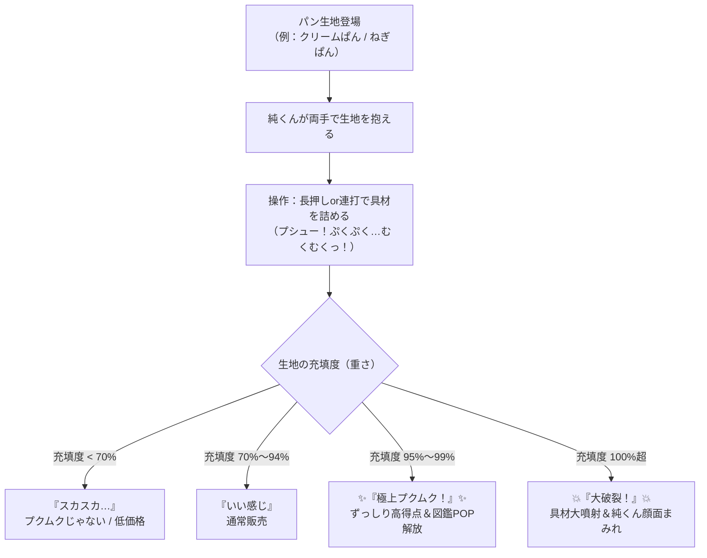

# 『純くんの朝6:30！プクムク・パン詰めパニック』ゲーム企画仕様書（改訂版）

## 1. コンセプト＆ゲーム概要
* **タイトル**：『純くんの朝6:30！プクムク・パン詰めパニック』
* **ジャンル**：物理パズル＆タイミングアクション
* **ターゲット**：プクムクの常連さん、パン好き、シュールで中毒性のあるカジュアルゲームが好きなプレイヤー
* **コア体験**：
  > **「プクムクのぱんは、小ぶりなのに具がぎっしり！」**
  > 朝6:30の開店までに、純くんが生地に具材を注入・投入し、はちきれんばかりの『極上プクムク状態』を目指す。
  > 限界を超えると大破裂して中身が純くんの顔面に直撃！
* **【重要・おことわり】**：
  > ※本ゲーム内の「パン生地に具材をポンプで注入する」「生地で巨大具材を無理やり包む」などの作り方・ギミックは、**ゲームを面白くするためのフィクション（架空の演出）**です。**実際の「パン工房プクムク」のパンの作り方・製法とは異なります**（ゲーム内のロード画面や図鑑内にも「※実際のパンの作り方とはまったく違います」と明記します）。
* **【権利・ライセンスについて】**：
  > 制作者本人が「パン工房プクムク」に関する著作権・知的財産権を正式に保有しています。そのため、店名・看板・キャラクター「純くん」・実在のパンメニュー等を公式コンテンツとしてゲーム内に全面的に使用・展開します。

---

## 2. プクムクの世界観と純くんのビジュアル再現方針

### 2.1 店頭・外観・看板の再現方針（想像での制作禁止・実物調査準拠）
* **看板・イラスト制作の原則**：
  * **想像や推測での制作は禁止**。必ず実在する店舗の外観写真、手描き看板、壁面アート、メニュー札、公式SNS等の資料をネットや実物で綿密に調査・リサーチした上で忠実に再現・落とし込みを行う。
* **手描きアメリカンポップ×昭和レトロ**：
  * 店主デザインのカラフルで少しシュールな壁面イラストをゲームの背景・UIフレームに採用。
  * メニュー名はお店に合わせて**「〜ぱん」**（ひらがな表記）を基本とする。
* **対面販売の小さなガラスショーケース＆手描きPOP**：
  * 外からカウンター越しに注文するプクムクのスタイルを再現。
  * 作ったパンがショーケースに並び、お店名物の「クスッと笑える手描きPOP」が添えられる。

### 2.2 3Dモデル「純くん（従業員・純利益）」のブラッシュアップ仕様
現在作成中のBlenderデータ（`純くん一時保存.blend`）を元に、店頭の「純くん」の特徴を強化するポイント：
1. **横向きの独特な視線**：
   * 店頭の人形最大の特徴である「少し横を向いて道行く人を見つめるような絶妙なアングル」を待機モーション（Idle）に取り入れる。
2. **衣装＆質感**：
   * レトロポップな色使い（赤・黄・青などの原色を効かせたダイナー/マスコット風のカラーリング）。
   * 看板人形らしい少しツヤのあるレトロトイ質感マテリアル。
3. **表情・リアクションモーフ（シェイプキー）**：
   * **通常**：横目で通りを見つめるシュールな真顔。
   * **注入中**：生地が膨らむにつれて目を見開き、プルプル緊張する顔。
   * **成功（極上プクムク！）**：パッと輝くドヤ顔。
   * **破裂（失敗）**：顔面がカスタードやチョコまみれになり、白目をむくシュール顔。

---

## 3. ゲームシステム仕様

### 3.1 実在の「プクムクのぱん」完全ラインナップとゲーム内ギミック
お店の実際のパンの特徴（製法・具材・人気ポイント）をそのままゲームのギミックに変換します。

#### 【ステージ1：定番・看板ぱん編】
| 実在メニュー名（公式表記） | お店での実際の特徴 | ゲーム内の詰め方・物理ギミック | 破裂・失敗時の演出 |
| :--- | :--- | :--- | :--- |
| **クリームぱん** | **不動のNo.1人気**。小ぶりなのにプリンのように濃厚な自家製カスタードがずっしり重い。 | 【注入系】最初は軽いが、後半一気に「ずっしり」重くなり生地が下に垂れ下がる。 | 純くんの顔面が黄色いカスタードまみれになる。 |
| **濃厚チョコクリームぱん** （または**チョコぱん**） | 準チョコではなく高価なチョコを使用。滑らかでプルッとした、とろ〜り濃厚チョコクリーム。 | 【注入系】カスタードより粘度が高く、指を離したあとも余韻で少し膨らむ（慣性あり）。 | 顔面が真っ黒のツヤツヤチョコまみれになる。 |
| **プクムクバーガー** （**チーズバーガー**） | 従業員一丸となって手捏ねした自家製ハンバーグ＆ピーマン等をパン生地で包んで焼き上げる名物。 | 【包み込み系】大きなハンバーグと具材を押し込み、生地が破れないギリギリで包み込む。 | 生地が弾けてハンバーグや具が画面手前に飛んでくる。 |
| **クリームメロン** | メロンパンの中にさらにクリームが入った贅沢ぱん。 | 【2段階系】外のクッキー生地にヒビが入るギリギリを見極める。 | クッキー生地がボロボロッと崩れ落ちる。 |

#### 【ステージ2：名物お惣菜・バーガー編】
| 実在メニュー名（公式表記） | お店での実際の特徴 | ゲーム内の詰め方・物理ギミック | 破裂・失敗時の演出 |
| :--- | :--- | :--- | :--- |
| **じゃがいもぱん** | 南台のソウルフード！北海道産じゃがいもに、あふれんばかりのマヨネーズがたまらない人気ぱん。 | 【ゴロゴロ詰め系】ホクホクじゃがいもを詰めた後、最後にマヨネーズを注入。形がボコボコ歪む。 | じゃがいもとマヨネーズがボフッ！と飛び散る。 |
| **3種のきのこぱん** （**きのこぱん**） | 「田舎のおじいさんから都会のお子様まで大人気」な旨味たっぷり惣菜ぱん。 | 【むくむく膨張系】きのこフィリングが中で「むく、むく、むくっ！」と段階的にリズムよく膨らむ。 | きのこがポンッ！と四方八方に飛び散る。 |
| **ねぎぱん** | シャキシャキのネギとパンの意外な組み合わせがクセになるファン多数の看板ぱん。 | 【押し込み系】シャキシャキのネギが飛び出さないよう、リズムよくトントン押し込む。 | ネギが噴水のように純くんの頭上に飛び散る。 |
| **トマトカレーパン** | トマトの酸味とコクが効いた食欲をそそる人気カレーパン。 | 【注入系（高速）】ルーがサラッとしていて膨らむスピードが速いスピード勝負。 | トマトカレーが純くんのエプロンに飛び散る。 |

#### 【ステージ3：ボリューム満点バーガー＆常連さん編】
| 実在メニュー名（公式表記） | お店での実際の特徴 | ゲーム内の詰め方・物理ギミック | 特別・失敗演出 |
| :--- | :--- | :--- | :--- |
| **さばかつバーガー** | 食べ応え抜群の香ばしいサバカツを豪快にサンドした名物魚系バーガー。 | 【豪快サンド系】分厚い「さばかつ」をタイミングよく挟み込み、サクサク感を残してギュッとまとめる。 | 力を入れすぎるとさばかつが滑って純くんの頬にペチッと当たる。 |
| **しゃけバーガー** | 手作りの温かみとジャンクな美味しさが共存する魚系バーガー。 | 【挟み込み系】しゃけフライとタルタルソースをはみ出さずにバウンドさせて挟む。 | タルタルソースがブチュッと飛び出す。 |
| **焼きそばパン** | マヨネーズとソースがたっぷり効いた昔ながらのジャンクな味。 | 【山盛り＋マヨ掛け】麺を盛ったあと、マヨネーズを限界までかける2段構え。 | 焼きそばが純くんの頭にリーゼントのように乗る。 |
| **レーズン食パン** | 地元のおじさんたちに根強い人気を誇る、レーズンぎっしりの食パン。 | 【連打注入系】生地の中にレーズンを「これでもか！」とマシンガン注入するボーナスタイム。 | 外で待つ常連のおじさんが大喜びして純利益アップ。 |
| **犬専用の無塩ひとくちパン** | お散歩中のワンちゃんのために作られた、ひとくちサイズの優しいパン。 | 【超繊細系】極小サイズのため、ほんの一瞬のタッチで止める精密ミッション。 | お店の前のワンちゃんが「ワン！」と喜んで尻尾を振る。 |

---

## 4. 【確定必須仕様】ゲームを面白くする3つの重要システム

### ① ショーケースの『手描きPOPぱん図鑑』
* ゲーム内で『極上プクムク！』を達成したパンは、タイトル画面の**「プクムクのガラスケース」**にコレクションされていく。
* コレクションされたパンをタップすると、**実際のお店の「手描きPOP風イラスト」と「実際のパンのこだわり紹介（例：本物のチョコを使ってます！等）」**が読める。
* **効果**：ゲームを遊ぶほど「このねぎぱん食べてみたい！」「クリームぱん買いに行こう！」と実店舗への来店動機が自然に高まる。

### ② 朝6:30の『常連さんリクエスト』システム
* プレイ中、カウンターの向こうに「お散歩中の犬連れさん」「早起きのおじさん」「部活前の学生」などのシルエットが登場。
* そのお客さんが欲しがっているパン（例：おじさん＝レーズン食パン）を『極上プクムク！』で仕上げると、**「常連ボーナス」**で売上が2倍になる。

### ③ スコア単位は『純利益』＆純くんの朝ポエム
* スコアは単なる「点」ではなく、純くんの本名（？）にちなんで**「本日の純利益：〇〇プク」**と表示。
* リザルト画面では、その日一番うまく作れたパン（または爆発したパン）に応じた**純くんのポエム**が表示される。
  > *「ずっしり重い クリームぱん。 持ったあなたの 手もぷくむく。 今日もいい１日になりますように。 純」*
  > *「ねぎぱんの ねぎが とびだした朝。 ぼくの心も とびだした。 純利益」*

---

## 5. 実装済みタクティカル・ゲームシステム＆3D演出仕様
1. **3アクション駆け引きシステム（プッシュ・ユア・ラック＆微調整）**：
   * **🥖 長押し注入＆余韻膨張（Space / 長押し）**：注入を止めた後も、パンごとの粘度慣性と酵母の発酵で**1.15秒間「ぷく〜っ…」と余韻膨張**が続く。その間に「追い注入」も可能。
   * **👋 ペシッ！ガス抜き（Xキー / Shiftキー / ボタン）**：「余韻で100%を超えて破裂しそう！」という瞬間に生地をペシッと叩き、**充填度を `-4.5%` 戻しつつ余韻慣性を85%カット**する緊急回避＆微調整アクション（純くんの右腕も連動してペシッと動く）。
   * **🛎️ 今すぐ並べる！（Enterキー / ボタン）**：95〜99.9%のスイートスポットに入った瞬間にベルを鳴らし、**余韻膨張を即座にストップしてその瞬間のパーセンテージで即確定・出荷**する。
2. **🌟 神プクムク判定（98.0%〜99.9%）＆ 💨 湯気ブラインド**：
   * 98.0%以上の極限領域で止めると**『🌟 神プクムク！！』**となり、純利益4倍＋コンボ+2＋制限時間+3.5秒回復！
   * 3コンボ以上や朝6:15以降の「開店前ラッシュ」では、焼きたての湯気でゲージ右端が曇る**『💨 湯気ブラインド』**が発生。3Dパン生地の透け具合、プルプル震え、木製トレイの黄金/虹色オーラリング、ポンプ音のピッチを手がかりに極限を見極める職人体験を実現。
3. **純くん3Dモデル（`純くん一時保存.blend` 完全再現）＆ 全13種パン3D造形**：
   * 制作者オリジナルの `純くん一時保存.blend` の造形・ピクセル球体フェイス・『PUKU MUKU』ロゴをそのまま `models/junkun.glb` として書き出し、注入時の緊張・ガス抜き時の右腕ペシッ・極上達成時のジャンプ・破裂時ののけぞり＆顔面トッピング付着をアニメーション。
   * 永続セーブ（`localStorage`）によるハイスコア記録＆5段階の**『職人称号（見習いバイト〜伝説の純利益マスター）』**を実装。

